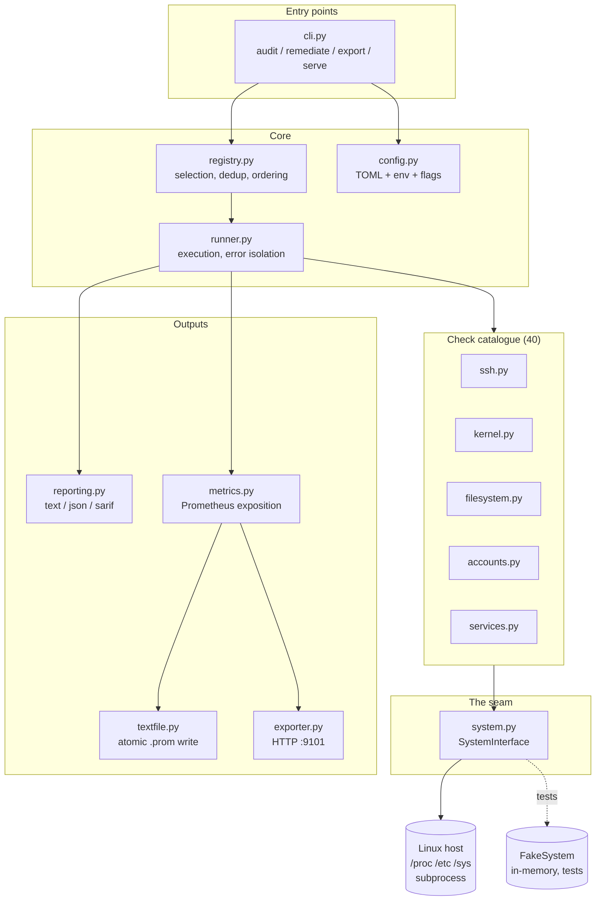

# Architecture

## Why this exists

A production Linux fleet has two related but distinct problems:

1. **Drift.** Hosts are provisioned hardened, then someone debugs a problem at
   2am and leaves `PermitRootLogin yes` behind. Nothing notices.
2. **Blindness.** Security posture is checked at audit time, quarterly, by a
   human with a spreadsheet — not continuously, by the same monitoring system
   that already pages when disk fills up.

This agent treats security posture as a **time series**, not a report. If disk
usage is a metric with an alert, so should be "is SSH root login enabled".

## The shape of the system



## The four decisions that shaped everything

### 1. One seam between the agent and the OS

Every filesystem read, every `subprocess` call, every privilege query goes
through `SystemInterface` ([system.py](../src/hardening_agent/system.py)).
Nothing else in the codebase imports `subprocess` or touches `open()` on a host
path.

Three things fall out of this, and all three are why the decision was worth
making:

**Testability.** `FakeSystem` in [conftest.py](../tests/conftest.py) is a
~120-line in-memory implementation. The entire 40-check catalogue is tested
against it, so CI validates real check logic on macOS, on Windows, without root,
without a VM. The alternative — a disposable Ubuntu box per test run — is slower,
flakier, and would have meant most checks never got tested at all.

**Auditability.** A reviewer confirms in one file that the agent never uses
`shell=True`, always passes argv as a list, and always sets an explicit `PATH`.
That review is 40 lines, not a grep across the whole tree.

**Deployment flexibility.** The `root` parameter means the container can inspect
the host at `/host` without any code in the checks knowing about it. `--root
/host` is the entire container story.

The cost: every new capability needs an interface method. When the collectors
needed disk capacity, `os.statvfs` had to become `SystemInterface.filesystem_stats`.
That is the tax, and it is worth paying — the direct `os.statvfs` call was
silently reporting the *container's* disk instead of the host's, and adding the
interface method is what surfaced the bug.

### 2. Zero runtime dependencies

`pyproject.toml` lists no runtime dependencies. Not "few" — none.

This process runs **as root, on every host in the fleet**. Every dependency in
that context is:

- a package that must be patched fleet-wide when it gets a CVE,
- code executing with root privileges that nobody on the team has read,
- a supply-chain path into the most privileged process on the box.

So: config is TOML via stdlib `tomllib` (3.11+), Prometheus exposition is
rendered by hand (~100 lines in [metrics.py](../src/hardening_agent/metrics.py)),
and the HTTP exporter is `http.server`.

**The honest trade-off.** `prometheus_client` is well-tested and I re-implemented
a subset of it. `http.server` is not a high-performance web server. Both are
acceptable *here* because the exposition format is a stable, simple text protocol
and the exporter serves three read-only GET endpoints on loopback to a handful of
scrapers. If this were a public API serving thousands of RPS, `http.server` would
be the wrong answer and I would take the dependency.

### 3. Audit-only by default; remediation is opt-in and reversible

A tool that rewrites `sshd_config` the first time you run it is a tool nobody
runs on a production host. The defence is layered:

| Layer | Mechanism |
| ----- | --------- |
| Default | `audit` never writes. `remediation.enabled = false`. |
| Intent | `remediate` refuses without `--yes`. |
| Preview | `--dry-run` prints the plan, touches nothing. |
| Privilege | Non-dry-run remediation requires root. |
| Blast radius | Access-severing fixes need `--allow-risky` on top. |
| Reversibility | Every file is copied to a backup set before modification. |
| Validation | SSH changes run `sshd -t` and roll back if it fails. |
| Honesty | The check is re-audited after remediation, so the report reflects reality. |

The `sshd -t` validation is the single most important line in the codebase. A
malformed `sshd_config` that gets reloaded ends remote access to the host,
permanently, with no way back in. So: write, validate, and if validation fails,
restore from backup and never reload. There is a test asserting exactly that
(`test_rolls_back_when_sshd_t_rejects_the_config`).

Some things are deliberately **not** remediable:

- `fs_tmp_separate_partition` — editing fstab can make a host unbootable.
- `accounts_single_uid_zero` — deleting an account automatically is worse than
  the finding.
- `services_no_pending_security_updates` — installing updates restarts services;
  that is a change-window decision, not an agent's call.
- Backup pruning reports what should be deleted but does not delete it.
  Recursive removal as root is not something this codebase will contain.

Refusing to automate something is an engineering decision, and stating why is
part of the deliverable.

### 4. Cached audits, decoupled from scrapes

An audit takes hundreds of milliseconds to seconds. A Prometheus scrape happens
every 15 seconds and has a timeout. Running the audit inside the scrape handler
would mean slow scrapes, and a slow scraper could stack up concurrent audits
until the host falls over.

So the exporter runs audits on a background thread on a fixed interval and
publishes to a lock-protected cache. HTTP handlers only ever read the cache.

The failure mode this creates — stale data if the audit thread wedges — is made
visible rather than hidden:

- `hardening_agent_exporter_metrics_age_seconds` is exported on every scrape.
- `/readyz` returns 503 once the cache is older than three refresh intervals, so
  an orchestrator restarts the process.

## Data flow through one audit

```
config.load_config()          file -> env -> CLI flags, unknown keys fatal
        |
CheckRegistry.with_defaults() 40 checks, duplicate ids rejected at construction
        |
registry.select(audit_cfg)    include AND tags AND min_severity, then exclude
        |                     sorted: severity desc, then id (deterministic)
        v
AuditRunner.run()
        |
        +-- for each check:
        |     try:    check.audit(ctx) -> Finding
        |     except: Finding.errored(...)      <- one bad check cannot abort
        |     if remediating and FAIL:
        |         remediate, then RE-AUDIT      <- report reflects reality
        |
        v
    Report (immutable)
        |
        +--> reporting.render()  text | json | sarif
        +--> metrics.build_report_metrics()
                    |
                    +--> textfile.write_textfile()   atomic, for node_exporter
                    +--> exporter cache               for HTTP scrape
```

## Notable design details

### Status is a numeric gauge, not a label

```
hardening_agent_check_status{check_id="ssh_root_login_disabled",...} 0
```

not

```
hardening_agent_check_status{check_id="...",status="fail"} 1
```

The second form creates a **new time series every time a check changes state**,
and the old series does not disappear — it goes stale and keeps reporting the old
value for as long as the retention window. An alert on
`status="fail"` would keep firing after the problem was fixed. This is one of the
most common Prometheus modelling mistakes and it is worth getting right.

### `SKIP` is not `FAIL`

A container host that enables `ip_forward` for bridge networking is not
misconfigured. An `sshd` check on a host with no `sshd` is not a finding. A
Debian-only `apt` check on RHEL is not a failure.

Every one of those reports `SKIP`, with a reason. False positives are not a
cosmetic problem — they train operators to ignore the tool, at which point the
true positives stop working too.

The score explicitly excludes skipped checks, so a host where most controls are
inapplicable does not score misleadingly well.

### `ERROR` outranks `FAIL` in the exit code

If a check throws, the host's posture for that control is **unknown**. Unknown is
not the same as non-compliant, and a CI pipeline must not treat it as merely
"needs attention". Exit code 2 means "the agent could not answer the question",
which is a defect in the agent, not the host.

### `Include` ordering in `sshd_config`

OpenSSH uses **first occurrence wins**, and Ubuntu ships
`Include /etc/ssh/sshd_config.d/*.conf` at the *top* of the file so drop-ins
override the main body. Getting this backwards would make the SSH checks report
the opposite of the truth on a stock Ubuntu cloud image. The parser expands
includes in place and uses `setdefault`, and there is a test for it.

`Match` blocks are ignored: options inside them are conditional on the connection
and cannot be evaluated statically. Reporting only global values is the
conservative reading.

### Check families

About 70% of a CIS-style baseline is three shapes repeated: "this sysctl must
equal X", "this file must be no looser than mode Y", "this sshd option must be
one of Z". Those are `SysctlCheck`, `FilePermissionCheck`, `SSHOptionCheck` in
[base.py](../src/hardening_agent/checks/base.py).

A new control is then a five-line subclass, and the genuinely tricky parts — the
sshd include ordering, the permission-ceiling semantics, the sysctl upsert — live
in one place with one set of tests. Concrete checks override `audit` only when
they need context-awareness (like `IPForwardingCheck` skipping on container
hosts).

Metadata is enforced at class-creation time via `__init_subclass__`, so a check
missing its rationale is an *import error* CI catches, not a blank row in a
report someone reads at 3am.

### Explicit registration, not auto-discovery

`checks/__init__.py` lists every check class explicitly rather than walking the
package with `pkgutil`. Auto-discovery is convenient right up until a
half-finished file silently changes the security posture reported for a fleet.
Adding a control should be a reviewable one-line diff.

## What this is not

- **Not a node_exporter replacement.** The host collectors gather the handful of
  signals that give a compliance report operational context. Run node_exporter
  alongside; the textfile collector is designed for exactly that.
- **Not a CIS benchmark implementation.** It is CIS-*derived*. 40 controls, not
  200+, chosen for signal over completeness.
- **Not multi-distro.** Ubuntu/Debian focused. Kernel, filesystem and account
  checks work anywhere; `apt`-based ones report `SKIP`.

## Where I would take it next

1. **Policy as data.** Move check definitions to declarative YAML/TOML so
   security engineers can add controls without writing Python. The family classes
   already model the shapes needed.
2. **Drift detection.** Store the previous report and emit
   `hardening_agent_drift_total` when a passing check starts failing — the
   *transition* is more actionable than the state.
3. **Fleet aggregation.** A `--push` mode targeting a Pushgateway or an
   OTLP endpoint, for hosts that cannot be scraped.
4. **eBPF-based runtime checks.** Currently everything is configuration state.
   Detecting actual behaviour (unexpected outbound connections, unusual privilege
   escalation) is a different and more interesting problem.
